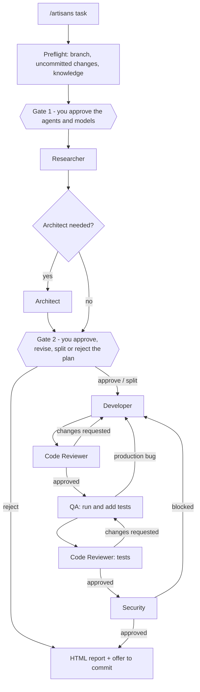

# Artisans

A small AI development team for **Claude Code** and **GitHub Copilot** (VS Code and the Copilot CLI). You give it a task with `/artisans <task>`. An orchestrator researches it, comes back to you with a plan, and only after you approve does the team build, review, test and security-check the change. Every run ends with an HTML report.

| Role | What it does | Writes code? |
|------|--------------|--------------|
| **Orchestrator** (the `/artisans` skill) | Talks to you, asks for approvals, delegates, tracks status, writes the report | no |
| **Researcher** | Finds where the task lands, the project's conventions, its tests, risks and open questions | no |
| **Architect** | Designs larger changes: components, contracts, data, steps (only when needed) | no |
| **Developer** | Implements the approved plan and fixes findings in **ub-mode**: failing test first, smallest change, root causes, then make it right (see below) | yes, plus failing-first tests |
| **Code Reviewer** | Reviews the code, then reviews QA's tests | no |
| **QA** | Checks the Developer's tests, adds edge, boundary and regression tests, runs the whole suite, reports production bugs | tests only |
| **Security Specialist** | Reviews the full diff for vulnerabilities, secrets and risky dependencies | no |

Two helper commands come with it:

| Command | What it does |
|---------|--------------|
| `/artisans-knowledge` | Reads your repository and writes the project knowledge base the agents work from: real toolchain commands, conventions, testing style, a review checklist, and project rules with critical zones. |
| `/artisans-setup` | Checks the installation: config, agent files, guard hook, git-ignore rules, knowledge freshness, missing tools, MCP servers. With `fix` it repairs what it can, asking you first. |

## The flow



- **Nothing happens without your approval.** Gate 1 runs before any subagent. Gate 2 runs before any code is written.
- **You choose the team.** At Gate 1 you pick which agents take part and which model profile they use. You can change either at Gate 2.
- **You are asked when something only you can do.** Examples: switching off `main`, connecting an MCP server, providing credentials or a spec, starting a service the tests need, reloading the window. The run stops and waits for you. It never guesses.
- **Rework loops are capped** (see [CONFIGURATION.md](CONFIGURATION.md)). When a cap is hit, you decide: one more round, accept as is, or stop.

## Install

You need Python 3 for the installer. The guard hook needs `bash`. macOS and Linux have it. On Windows, install [Git for Windows](https://git-scm.com/download/win) (`winget install --id Git.Git -e`), which includes Git Bash. The WSL launcher alone is not enough, because the hook would run outside your Windows project.

The installer checks for bash and shows what it found. It also finds Git Bash in its usual folders when it isn't on PATH, and tells you what to add to PATH. If bash is missing, the install still finishes, but the guard does nothing until you fix it. Everything else works.

```bash
git clone <this-repo> ~/artisans

# Claude Code
python3 ~/artisans/install.py claude  /path/to/your/project

# GitHub Copilot (VS Code + Copilot CLI)
python3 ~/artisans/install.py copilot /path/to/your/project

# both
python3 ~/artisans/install.py both    /path/to/your/project
```

Useful options: `--dry-run` (show the plan), `--profile economy|balanced|max` (the default model profile), `--no-hooks`, `--force` (replace files you edited, with a backup), `--reset-config`, and `--yes` (non-interactive).

What gets written:

| | Claude Code | GitHub Copilot |
|-|-------------|----------------|
| Agents | `.claude/agents/artisans-*.md` | `.github/agents/artisans-*.agent.md` |
| Orchestrator, config, templates, guard | `.claude/skills/artisans/` | `.github/skills/artisans/` |
| Knowledge generator + stack cards | `.claude/skills/artisans-knowledge/` | `.github/skills/artisans-knowledge/` |
| Setup checker | `.claude/skills/artisans-setup/` | `.github/skills/artisans-setup/` |
| Guard hook wiring | merged into `.claude/settings.json` (after asking; a backup is kept) | `.github/hooks/artisans.json` |

After installing:

1. Restart Claude Code, or reload VS Code (*Developer: Reload Window*) or restart the Copilot CLI.
2. **Copilot only:** open `.github/agents/artisans-*.agent.md` and check that each `model:` name matches your Copilot model picker. Change them in `config.json` if needed (see [CONFIGURATION.md](CONFIGURATION.md)).
3. **VS Code only:** turn on the `chat.useHooks` setting if you want the guard hook. Hooks are a preview feature.
4. In the project, run **`/artisans-setup`**. It reports anything that still needs your attention.
5. Run **`/artisans-knowledge`** once. It writes `.artisans/knowledge/`, which is shared by Claude Code and Copilot. Commit that folder so your whole team gets the same knowledge.

Re-running the installer upgrades the team in place. It keeps your `config.json` values but adds any new settings to it, and it refuses to overwrite files you edited by hand unless you pass `--force`.

## Project knowledge

The agents know nothing about your stack in advance. `/artisans-knowledge` reads your repository (CI pipelines first, then task runners, manifests, docs and real source and test files) and writes these files to `.artisans/knowledge/`:

| File | Read by | Contents |
|------|---------|----------|
| `PROJECT-OVERVIEW.md` | Researcher, Architect, Security | Stack, layout, architecture and request flow, domains, user interface |
| `TOOLCHAIN.md` | Developer, Reviewer, QA | The **only** commands agents may run: format, lint, type-check, build, test all/one. Each one was executed once to verify it, and marked cheap or expensive. |
| `CONVENTIONS.md` | Developer, Reviewer, Architect | Naming, structure, errors, logging, config and secrets, security, anti-patterns. Each rule is marked `[observed]` or `[not followed]` against the real code. |
| `TESTING.md` | QA, Reviewer | Frameworks, test location and naming, shared fixtures, how to run tests, gaps |
| `REVIEW-CHECKLIST.md` | Reviewer, Security | Numbered checks applied to every diff |
| `PROJECT-RULES.md` | everyone | Obligations ("when X changes, update Y"), prohibitions, **critical zones** (auth, payments, migrations, …) |
| `LEARNINGS.md` | orchestrator | Inbox of traps that runs discovered. `/artisans-knowledge all` turns them into rules (after asking you). |

Stack rules come from the stack cards in `skills/artisans-knowledge/standards/` (Go, Python, C#, JavaScript, TypeScript, plus a generic card), and from `interface.md` for projects with a UI. The generator detects which cards apply, then checks every card rule against your code: where your code does something else, your code wins.

| Command | What it does |
|---------|--------------|
| `/artisans-knowledge` or `all` | Writes everything and triages the learnings inbox. The old folder is backed up first. |
| `/artisans-knowledge check` | Reports stale files (commits behind, changed CI or manifest files, paths that no longer exist) without writing anything |
| `/artisans-knowledge TOOLCHAIN.md` | Regenerates only the named files |

Without knowledge files the team still works: the agents explore the repository directly, which is slower and less consistent. When knowledge is missing, `/artisans` asks you first. On an empty project, the generator asks which stack you plan to use and writes marked scaffolds.

## Use

In your project, in Claude Code chat or Copilot chat (Agent mode):

| Command | What it does |
|---------|--------------|
| `/artisans <task>` | Starts a run |
| `/artisans status` | Where the current run is, plus a fresh HTML report |
| `/artisans report` | Regenerates the HTML report only |
| `/artisans stop` | Parks the run; nothing is lost |
| `/artisans resume [run_id]` | Continues a parked run (models and agents are re-confirmed) |
| `/artisans-knowledge [all \| check \| FILE.md]` | Builds or checks the project knowledge (see above) |
| `/artisans-setup [check \| fix]` | Checks or repairs the installation |

### What you will be asked

**Gate 1, kickoff** (one dialog):

1. Which analysis agents: Researcher and/or Architect.
2. Which delivery agents may be used if you approve the plan: Developer, Code Reviewer, QA, Security.
3. Which model profile: `economy`, `balanced` or `max`, each with a preview of role → model. You can also type your own mapping, for example `developer=opus, qa=haiku`.

**Gate 2, plan** (after research): **Approve**, **Split into subtasks** (you then choose which ones to run now and in what order; the rest stay deferred), **Revise** (type what to change), or **Reject**. Any open questions from the research are asked in the same dialog.

**At the end:** the result, the changed files, open findings, things to verify by hand, the path to the report, and the Developer's **commit plan**: small ordered commits, each with why, what changed and how it was proven. You choose "Create these N commits", "One squashed commit", "I'll commit myself" or "Leave uncommitted". It never commits without your yes, and it never pushes.

### How the Developer works (ub-mode)

The Developer prompt (`agents/artisans-developer.md`) follows ub-mode, adapted to the team's approval rules:

| ub-mode | In this team |
|---------|--------------|
| **Make it work:** laziness protocol, foundational thinking, domain modelling, boundary and type discipline, idempotency, no shared mutable state | Applied to every change |
| TDD | A failing test for each changed behaviour; it must fail for the expected reason before the change. QA then adds edge cases. |
| Redesign from first principles | Never done silently. The Developer implements the approved plan's minimum and writes a **redesign proposal**, which the orchestrator shows you. |
| Attack the premise | After two failed fixes on the same gate, the Developer writes down the shared premise before a third attempt, and the orchestrator shows it to you. |
| Build the lever | Do one unit by hand, then a small tool for the rest. The tool lives in the run folder, never in your project. |
| **Make it right:** root causes, verifiable units, behaviour tests, refactoring | Applied to every change |
| Crapper / Dryer / Mutator | Run only if `TOOLCHAIN.md` has `Crap`, `Duplication` or `Mutation` rows (CRAP < 10, duplication ≥ 0.8 removed, survivors killed). Otherwise reported as "not available"; never installed. |
| **Practice:** keep a log, guard the context | An action log in `dev-notes.md`; bulky output goes to `dev-logs/` |
| Worktree cleanup | Deletes only files it created itself. Anything else waits for your decision. |
| Commit and push | Commit units are recorded and offered to you at the end. Never pushed. |

Deselecting a role skips its stage, and the report shows the stage as skipped. Without the Developer, a run is analysis-only and ends after the plan.

### The report

Each run is written to `.artisans/runs/{date}-{slug}/`:

```
status.md            phases, team & models, decisions, timeline, what's waiting on you
research.md          Researcher
architecture.md      Architect (if used)
plan.md              the plan you approved
dev-notes.md         Developer, one section per round
reviews/             code-review-N.md, test-review-N.md
qa-N.md              QA rounds
security-N.md        Security rounds
report.html          the HTML status report
```

`report.html` is a single self-contained file that works offline and follows your light/dark setting. It shows:

- the overall status, branch and baseline
- the pipeline stages with rework rounds
- what is waiting on you
- each agent's model and verdict
- the approved plan
- every changed file with +/− counts and why it changed
- every review finding and how it was resolved
- test counts and the tests that were added
- security findings
- the decisions made, the next steps, and a timeline

It stays a local file and is never published anywhere. Open it in any browser; set `report.autoOpen` to open it automatically.

The orchestrator offers to add `.artisans/` to `.gitignore` on the first run.

## Claude Code vs Copilot

The prompts are the same for both hosts. The differences:

| | Claude Code | GitHub Copilot |
|-|-------------|----------------|
| Question dialog | `AskUserQuestion` | `vscode/askQuestions` (VS Code), `ask_user` (CLI) |
| Subagent call | `Agent` tool | `runSubagent` (VS Code), `task` (CLI) |
| How the approved model is applied | passed on each subagent call | the `model:` line in each agent file. If you approve a model that differs from the file, the orchestrator asks before editing that line. VS Code may need a window reload afterwards. |
| Model names | `haiku`, `sonnet`, `opus`, `fable` | names as the model picker shows them, e.g. `Claude Sonnet 5.5 (copilot)` |
| Agent tools | `Read, Grep, Bash, …` | translated to `read, search, execute, edit, web` by the installer |

## Configuration

Everything you can change is listed in **[CONFIGURATION.md](CONFIGURATION.md)**: models and profiles, which agents are on by default, the Architect policy, rework limits, which security severities block, protected branches, commit behaviour, the report, and the guard. It also covers editing prompts, giving an agent MCP tools, and adding a new role.

## Repository layout

```
install.py                     installer for both hosts + self-test (python3 install.py check)
agents/artisans-*.md           the six subagent prompts (Claude Code format; translated for Copilot)
skills/artisans/
  SKILL.md                     the orchestrator (/artisans)
  config.json                  default configuration (copied into each project)
  templates/                   status.md, handoff.md, report.html
  hooks/guard-command          blocks destructive shell commands while a run is active
  hooks/*.json                 hook wiring for Claude Code and Copilot
skills/artisans-knowledge/
  SKILL.md                     the knowledge generator (/artisans-knowledge)
  standards/*.md               stack cards: detect, toolchain, conventions, review checks per language
  interface.md                 UI heuristics and review checks (projects with a user interface)
skills/artisans-setup/
  SKILL.md                     the installation checker (/artisans-setup)
CONFIGURATION.md               every setting explained
```

## Self-test

```bash
python3 install.py check
```

It validates:

- `config.json`: every agent has a prompt file and a model in every profile, the Claude aliases are allowed values, and the knowledge settings are valid
- every skill's and agent's frontmatter, and the agents' return blocks
- the stack cards' required sections
- the report template's data block and the hook JSON

It also builds both editions, and runs the guard hook against commands it must deny or allow, including the TOOLCHAIN exemption.

## The guard

While a run is active (`.artisans/active` exists), the guard denies these shell commands for every agent:

- killing processes by name (`pkill`, `killall`, `kill $(pgrep …)`)
- recursive `rm` of wide targets (`/`, `~`, `.`, `..`, globs)
- force pushes
- `git clean -f`
- commands that discard uncommitted work (`git reset --hard`, `git checkout -- <path>`, `git restore <path>`)

Outside a run it does nothing. A command written exactly as a Command cell in `.artisans/knowledge/TOOLCHAIN.md` is allowed: the knowledge file is the permission. It must be an exact match, not a prefix.

## Uninstall

Delete `.claude/agents/artisans-*.md` and `.claude/skills/artisans*/`, and remove the `artisans/hooks/guard-command` entry from `.claude/settings.json`. For Copilot, delete `.github/agents/artisans-*.agent.md`, `.github/skills/artisans*/` and `.github/hooks/artisans.json`. Run history and knowledge live in `.artisans/`.
